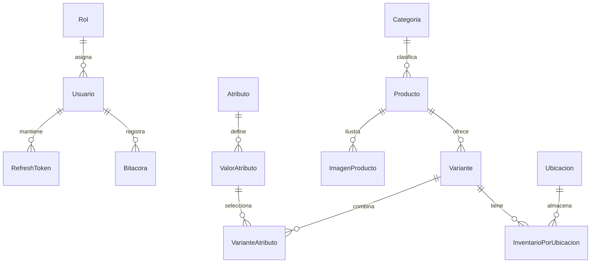
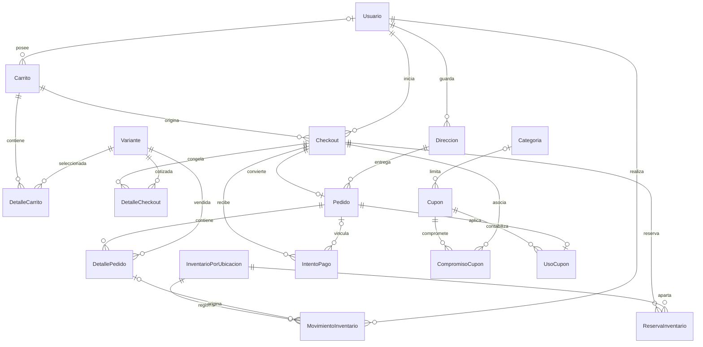
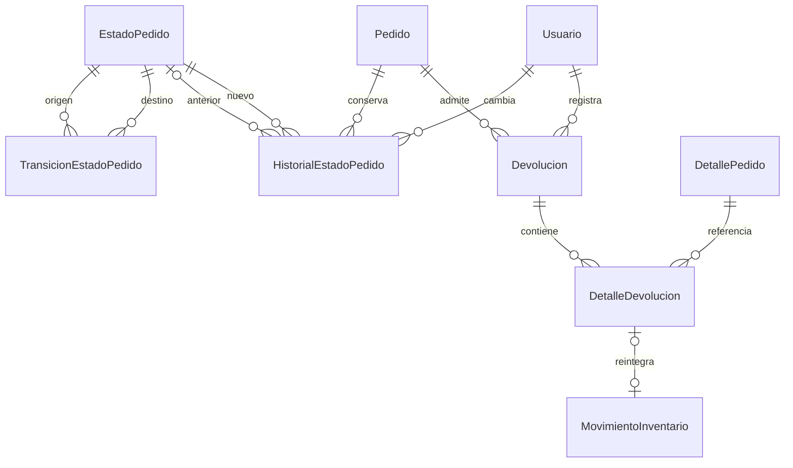
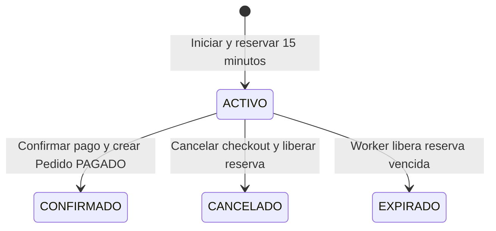
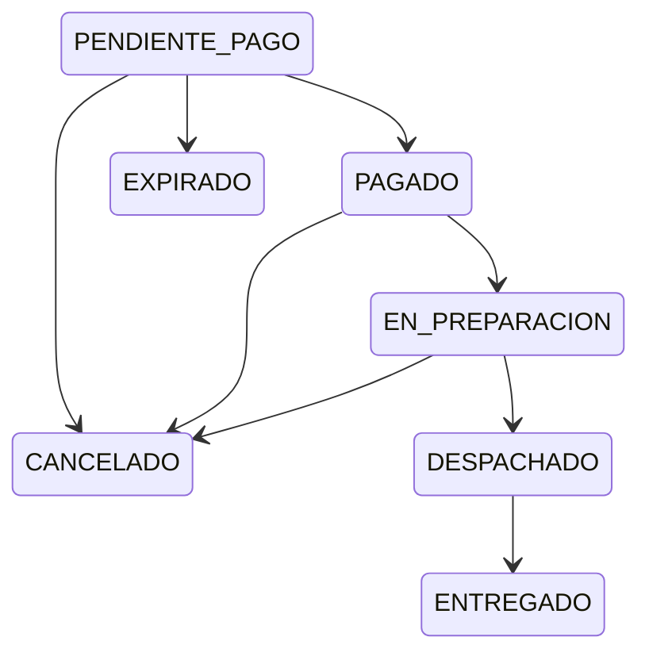

# ShopCart — Tech Challenge 360°

Plataforma de comercio electrónico desarrollada para el **Tech Challenge 360° de Grupo Pentandra**. El objetivo es administrar catálogo e inventario y convertir un carrito en un pedido sin sobreventa ni efectos duplicados ante reintentos.

El alcance entregado en este repositorio es **base de datos y backend en desarrollo**: SQL Server, Node.js, Express 5 y TypeScript estricto. El frontend React 18+ requerido por el concurso todavía no está implementado. Existen requisitos obligatorios pendientes; esta entrega no se presenta como lista para producción.

La referencia funcional es *Tech Challenge 360 - Reto ShopCart - Enunciado.pdf*, documento externo proporcionado por el desarrollador. Establece SQL Server 2019+, Node.js 24 LTS+, Express/TypeScript y React/TypeScript, con acceso a datos exclusivamente mediante stored procedures. Los montos son GTQ; los precios publicados incluyen IVA del 12 %. No existe un cálculo fiscal o desglose de IVA adicional en la API actual.

## 1. Requisitos previos

- Git y acceso al repositorio privado para clonarlo.
- Node.js **24 LTS o superior**, con npm. Las pruebas locales de integración se ejecutaron con Node.js 24.14.0.
- SQL Server **2019 o superior**. El entorno de QA utilizado fue SQL Server 2022 Developer.
- SQL Server Management Studio u otro cliente que interprete separadores `GO`; para los comandos siguientes se utiliza `sqlcmd` clásico ODBC.
- Una cuenta administrativa para crear la base y el login SQL de aplicación. Habilitar autenticación mixta, TCP/IP y un puerto conocido en SQL Server. El backend usa usuario/contraseña SQL, no autenticación integrada de Windows.
- PowerShell para seguir los ejemplos de instalación y HTTP. En Windows, si la política bloquea `npm.ps1`, usar `npm.cmd` en lugar de `npm`.

No hay Docker Compose, frontend, instalador de datos de demostración ni script npm en la raíz.

## 2. Instalación desde cero

### 2.1. Obtener el proyecto e instalar dependencias

```powershell
git clone https://github.com/ArielBM/shopcart-tech-challenge-360.git
cd shopcart-tech-challenge-360
cd backend
npm ci
Copy-Item .env.example .env
```

`npm ci` utiliza `backend/package-lock.json`. Los comandos npm de este documento se ejecutan dentro de `backend`; los de SQL, desde la raíz. Si una dependencia nativa como Argon2 no dispone de un binario compatible con el sistema, su instalación puede requerir herramientas de compilación de Node.js.

### 2.2. Configurar el entorno

Completar `backend/.env` a partir de estos valores de referencia; los campos vacíos son obligatorios:

```dotenv
NODE_ENV=development
PORT=3000
DB_SERVER=localhost
DB_PORT=1433
DB_NAME=ShopCartDB
DB_USER=shopcart_app
DB_PASSWORD=
DB_ENCRYPT=true
DB_TRUST_SERVER_CERTIFICATE=true
CORS_ORIGIN=http://localhost:5173
JWT_SECRET_BASE64=
```

- `DB_SERVER` y `DB_PORT`: host y puerto TCP reales de la instancia. `1433` es el valor de ejemplo, no una garantía sobre la instalación local.
- `DB_NAME`: los scripts seleccionan explícitamente `ShopCartDB`; cambiar solo esta variable no cambia el destino de los scripts.
- `DB_USER`/`DB_PASSWORD`: credenciales del login configurado en el paso siguiente. No usar la cuenta administrativa para ejecutar la API.
- `JWT_SECRET_BASE64`: secreto aleatorio que debe decodificar exactamente a 32 bytes. Generarlo localmente y pegar el resultado en `.env`:

  ```powershell
  node -e "console.log(require('node:crypto').randomBytes(32).toString('base64'))"
  ```

- `CORS_ORIGIN`: origen exacto permitido, sin rutas. `http://localhost:5173` solo es un ejemplo para el futuro frontend.
- `DB_ENCRYPT=true` cifra la conexión; confiar en el certificado del servidor es una facilidad local. Para un despliegue con certificados válidos, configurar `DB_TRUST_SERVER_CERTIFICATE=false` y HTTPS para la API.

Los archivos `.env` están ignorados por Git. No publicar secretos, cookies ni tokens en capturas o registros.

### 2.3. Crear la base y sus objetos

**Solo para una instalación nueva.** `001–003` crean tablas y no son migraciones incrementales reejecutables. No ejecutar esta secuencia sobre una base con datos que se deban conservar. Una instancia existente necesita una migración revisada específicamente para su esquema.

Ejecutar los archivos completos, en orden numérico, conservando sus separadores `GO` y usando una cuenta administrativa:

```text
001_EstructuraBase.sql                 Roles, usuarios, catálogo e inventario
002_EstructuraComercial.sql            Carrito, checkout, pedidos, pagos y kardex
003_EstructuraAuditoria.sql            Sesiones, estados, devoluciones y bitácora
004_DatosBase.sql                      Roles, BOD-CENTRAL, estados y transiciones
005_ConfigurarAccesoAplicacion.sql     Login/usuario SQL y permiso EXECUTE
006_SP_Autenticacion.sql               5 SP
007_SP_Catalogo_Categorias.sql          3 SP
008_SP_Catalogo_Productos.sql           3 SP
009_SP_Catalogo_Variantes.sql           4 SP
010_SP_Catalogo_Atributos.sql           2 SP
011_SP_Inventario.sql                  4 SP
012_SP_Carrito.sql                     4 SP
013_SP_Checkout.sql                    4 SP
014_SP_Direcciones.sql                 2 SP
015_SP_Pagos.sql                       2 SP
016_SP_Bitacora.sql                    1 SP
```

Desde la raíz, este ejemplo ejecuta `001–004` con autenticación de Windows y detiene la secuencia al primer error:

```powershell
$servidorSql = 'localhost,1433' # Cambiar por la instancia/puerto reales
Get-ChildItem .\db\00[1-4]_*.sql | Sort-Object Name | ForEach-Object {
    sqlcmd -S $servidorSql -E -C -I -b -f 65001 -i $_.FullName
    if ($LASTEXITCODE -ne 0) { throw "Error al ejecutar $($_.Name)" }
}
```

`-C` confía en el certificado para el entorno local; no sustituye la configuración TLS de un despliegue. `-I` habilita `QUOTED_IDENTIFIER`, necesario para trabajar con índices filtrados. Si no se dispone de autenticación integrada, ejecutar los archivos en un cliente con una conexión administrativa autenticada, sin guardar su contraseña en el repositorio.

**Paso manual obligatorio para `005`:** abrirlo en el cliente SQL y sustituir el marcador `REEMPLAZAR_POR_CONTRASENA_SEGURA` por una contraseña local propia antes de ejecutar el contenido. No ejecutar el marcador literalmente ni guardar la contraseña en el archivo versionado. El login es `shopcart_app`; copiar la misma contraseña a `DB_PASSWORD`. Si el login o usuario ya existen, revisar sus definiciones y permisos: `005` no comprueba su existencia.

Después de configurar `005`, instalar `006–016`:

```powershell
Get-ChildItem .\db\*.sql |
    Where-Object { $_.Name -match '^(00[6-9]|01[0-6])_' } |
    Sort-Object Name | ForEach-Object {
        sqlcmd -S $servidorSql -E -C -I -b -f 65001 -i $_.FullName
        if ($LASTEXITCODE -ne 0) { throw "Error al ejecutar $($_.Name)" }
    }
```

La reconstrucción vigente contiene **31 tablas y 34 procedimientos almacenados**. `013` define Iniciar, ExpirarReservas, Cancelar y ConfirmarPago; su encabezado menciona además `SP_Checkout_DetalleCheckout`, pero ese procedimiento no está definido.

### 2.4. Datos y cuentas para la evaluación

Las semillas crean tres roles, `BOD-CENTRAL`, siete estados de pedido y ocho transiciones. **No crean usuarios, credenciales de prueba, categorías, productos, variantes ni existencias.** Por ello, una instalación limpia puede responder correctamente con catálogos vacíos.

El registro HTTP crea exclusivamente clientes. Para preparar la demostración:

1. Registrar las cuentas mediante `/auth/register` y comprobar el login.
2. Un administrador de BD debe asignar explícitamente los roles internos a las cuentas de evaluación. No existe endpoint de administración de usuarios ni SP específico para cambiar roles. Por ejemplo, después de registrar una cuenta con un correo elegido para la demo, ejecutar administrativamente lo siguiente, sustituyendo el correo:

   ```sql
   USE ShopCartDB;
   DECLARE @CorreoDemo NVARCHAR(254) = N'evaluador@example.invalid';
   UPDATE u SET IDRol = r.IDRol
   FROM dbo.Usuario AS u
   CROSS JOIN dbo.Rol AS r
   WHERE u.Correo = @CorreoDemo AND r.Codigo = 'ADMINISTRADOR';
   ```

   Volver a iniciar sesión para obtener un JWT con el rol asignado. Esta operación de aprovisionamiento manual no forma parte del acceso a datos del backend.

3. Crear categoría y producto mediante la API administrativa. Crear las variantes con `SP_Catalogo_CrearVariante` de `009`, porque todavía no existe API de variantes. Sus parámetros reales son `IDProducto`, `SKU`, `PrecioActual` e `IDUsuario`; utilizar los identificadores creados en esa instalación. Registrar existencias mediante `/inventory/entries`, usando el ID real de `BOD-CENTRAL`.

El responsable de la entrega debe proporcionar al evaluador las cuentas y contraseñas temporales de demo por un canal separado. No hay credenciales predefinidas que este README pueda publicar.

## 3. Ejecución y comprobación

Dentro de `backend`:

```powershell
npm run typecheck
npm run lint
npm run build
npm run dev
```

`dev` carga `.env` y ejecuta `src/server.ts` con `tsx` en modo observación. También existen `dev:development` y `dev:production`, que cargan respectivamente `.env.development` y `.env.production`; esos archivos deben crearse localmente y no reemplazan el build de entrega.

Para ejecutar la compilación con el `.env` local:

```powershell
node --env-file=.env dist/server.js
```

`npm start` ejecuta `node dist/server.js`, pero **no carga `.env`**: requiere que todas las variables ya estén presentes en el entorno del proceso.

En otra terminal:

```powershell
Invoke-RestMethod http://localhost:3000/api/v1/health
Invoke-RestMethod http://localhost:3000/api/v1/products
```

Health devuelve `{"status":"ok"}`. El servidor conecta a SQL Server antes de escuchar; si falla el arranque, registra el error y establece código de salida 1. Health no ejecuta una consulta SQL en cada petición y no es una comprobación continua de disponibilidad de BD.

Al iniciar la API también arranca el procesamiento de reservas vencidas. Verificar `DB_NAME` antes de arrancarla: no conectar un proceso de pruebas a desarrollo.

## 4. Arquitectura y base de datos

```text
backend/
  src/
    config/          Variables y configuración de aplicación, BD y JWT
    database/        Pool reutilizable de mssql
    middlewares/     Autenticación, roles, validación de errores y rate limiting
    modules/
      auth/ categories/ products/ inventory/
      cart/ checkout/ addresses/ payments/ audit/
    routes/          Composición bajo /api/v1 y health
    app.ts           Express y middlewares globales
    server.ts        Conexión inicial, escucha HTTP y expiración
db/                  Scripts SQL numerados 001–016
README.md
```

Monolito modular, sin ORM ni herramientas de monorepo. Las rutas aplican autenticación y roles; los controladores validan entradas con Zod y adaptan HTTP; los servicios coordinan el caso de uso; los repositorios invocan SP con parámetros tipados de `mssql`. Las reglas que requieren atomicidad, bloqueos e integridad se ejecutan en SQL Server. El backend no construye consultas SQL directas para acceder a datos.

El modelo distingue ficha de producto y variante vendible. El inventario se almacena por variante/ubicación; las reservas están separadas de los movimientos físicos. La cotización y el pedido conservan valores históricos. PK, FK, UNIQUE, CHECK, defaults e índices filtrados protegen cantidades, propietarios, claves y unicidad de pagos exitosos. Los importes comerciales usan `DECIMAL(18,2)`; algunos cálculos intermedios usan `DECIMAL(38,2)`.

Las operaciones transaccionales emplean `TRY/CATCH`, rollback y `XACT_ABORT`; checkout, carrito, pagos e inventario utilizan `sp_getapplock` y bloqueos según el recurso. Esto respalda las reglas bajo concurrencia; no equivale a una garantía general de ausencia de deadlocks.

`shopcart_app` recibe `EXECUTE` sobre el esquema `dbo`, no permisos directos de lectura/escritura sobre tablas. Este permiso permite ejecutar todos los SP de ese esquema: el backend mantiene la autorización por rol y los SP comerciales comprueban propiedad. La cuenta SQL no debe distribuirse a clientes ni exponerse a Internet. La bitácora admite inserciones y un trigger rechaza `UPDATE`/`DELETE`; las cuentas administrativas de SQL Server quedan fuera de esa frontera de permisos.

## 5. API HTTP existente

Prefijo: **`/api/v1`**. Para rutas protegidas enviar `Authorization: Bearer <accessToken>`. La identidad se obtiene del JWT; los endpoints de cliente no aceptan `idUsuario` libre en el body.

### Rutas públicas y autenticación

- `GET /health`: comprobación de proceso, 200.
- `POST /auth/register`: registro CLIENTE, 201. Body: `nombre`, `correo`, `contrasena` (8–128 caracteres).
- `POST /auth/login`: credenciales, 200; entrega `data.accessToken` y cookie de refresh.
- `POST /auth/refresh`: rota la cookie de refresh, 200; no requiere access token.
- `POST /auth/logout`: revoca la familia del refresh y borra la cookie, 204; idempotente incluso sin cookie.

Las cuatro rutas de autenticación tienen limitadores independientes en memoria: cinco solicitudes por IP cada quince minutos. El exceso devuelve 429. Para refresh/logout, el cliente debe conservar y enviar la cookie.

### Catálogo

- `GET /categories`: público, solo activas. `GET /categories/admin?soloActivas=false`: ADMINISTRADOR, incluye inactivas; por defecto solo activas.
- `POST /categories`: ADMINISTRADOR, 201; `nombre`, `descripcion` opcional/null.
- `PUT /categories/:idCategoria`: ADMINISTRADOR, 200; los mismos campos y `activa`.
- `GET /products`: público, productos activos. `GET /products/admin`: ADMINISTRADOR, incluye productos inactivos.
- `POST /products`: ADMINISTRADOR, 201; `idCategoria`, `nombre`, `descripcion` opcional/null.
- `PUT /products/:idProducto`: ADMINISTRADOR, 200; los mismos campos y `activo`.

Productos admite `busqueda`, `idCategoria`, `precioMinimo`, `precioMaximo`, `soloDisponibles`, `orden`, `pagina` y `tamanoPagina`. Los precios de filtro son cadenas decimales; `orden` acepta `NOMBRE_ASC`, `NOMBRE_DESC`, `PRECIO_ASC`, `PRECIO_DESC`. Página desde 1, tamaño 1–100, por defecto 20. Categorías no está paginado. La desactivación se realiza por PUT; no hay DELETE físico ni rutas HTTP de variantes, atributos o imágenes.

### Inventario — OPERADOR o ADMINISTRADOR

- `POST /inventory/entries`: 201; `idVariante`, `idUbicacion`, `cantidad` entera positiva y `motivo`.
- `POST /inventory/adjustments`: 201; `idVariante`, `idUbicacion`, `cantidadCambio` entera distinta de cero y `motivo`.
- `GET /inventory`: 200; filtros opcionales `idVariante`, `idUbicacion`; sin paginación.
- `GET /inventory/kardex`: 200; `idVariante` obligatorio, `idUbicacion`, `fechaDesde`, `fechaHasta`, `pagina`, `tamanoPagina` opcionales. Fechas ISO 8601 con zona horaria; tamaño 1–100.

### Carrito, direcciones, checkout y pago — CLIENTE

- `GET /cart`: 200; líneas, cantidades, subtotal, descuento y total.
- `POST /cart/items`: 201; `idVariante`, `cantidad` entera positiva.
- `PATCH /cart/items/:idVariante`: 200; `cantidad` entera positiva.
- `DELETE /cart/items/:idVariante`: 204 sin contenido.
- `POST /addresses`: 201; `nombreDestinatario`, `departamento`, `municipio`, `direccionTexto`; `telefono` y `referencia` opcionales/null.
- `GET /addresses`: 200; solo direcciones activas del propietario. No hay PUT/DELETE.
- `POST /checkout`: 201 nuevo o 200 reutilizado; `claveInicio` UUID.
- `POST /checkout/:idCheckout/cancel`: 200; cancela el checkout propio según su estado. No es cancelación de un pedido pagado.
- `POST /payments/:idCheckout/process`: 201 nuevo o 200 reutilizado; `idDireccion` como cadena BIGINT positiva y `claveIdempotencia` UUID. Procesamiento simulado, sin datos bancarios.

### Bitácora — ADMINISTRADOR

- `GET /audit`: 200; consulta registros de auditoría, con filtro opcional `modulo`, `pagina` (desde 1) y `tamanoPagina` (1–100, por defecto 20). Devuelve `data` y `pagination.totalRegistros` como cadena para preservar BIGINT. Requiere JWT con rol `ADMINISTRADOR`; `CLIENTE` y `OPERADOR` no están autorizados.

El procedimiento `SP_Bitacora_Consultar` devuelve los eventos por `FechaAccion DESC, IDBitacora DESC`. Esta API solo consulta; no ofrece creación, edición ni eliminación de registros.

No hay endpoints para consultar pedidos, avanzar su estado, devolverlos, administrar cupones/usuarios o generar reportes.

### Ejemplo mínimo de cliente

Ejecutar con la API activa y los datos comerciales ya preparados. El correo es ficticio y la contraseña se solicita localmente; no representa una cuenta semilla:

```powershell
$base = 'http://localhost:3000/api/v1'
$credencial = Get-Credential -UserName 'cliente@example.invalid' -Message 'Contraseña local para la cuenta de demo'
$body = @{
    nombre = 'Cliente de evaluación'
    correo = $credencial.UserName
    contrasena = $credencial.GetNetworkCredential().Password
} | ConvertTo-Json
Invoke-RestMethod -Method Post -Uri "$base/auth/register" -ContentType 'application/json' -Body $body
$loginBody = @{
    correo = $credencial.UserName
    contrasena = $credencial.GetNetworkCredential().Password
} | ConvertTo-Json
$sesion = Invoke-RestMethod -Method Post -Uri "$base/auth/login" -ContentType 'application/json' -Body $loginBody -SessionVariable cookies
$headers = @{ Authorization = "Bearer $($sesion.data.accessToken)" }
Invoke-RestMethod -Uri "$base/products?soloDisponibles=true&pagina=1&tamanoPagina=20"

# Sustituir por una variante activa con stock creada en esta instalación.
$idVariante = [int](Read-Host 'IDVariante disponible')
Invoke-RestMethod -Method Post -Uri "$base/cart/items" -Headers $headers -ContentType 'application/json' -Body (@{idVariante=$idVariante; cantidad=1} | ConvertTo-Json)
$direccion = Invoke-RestMethod -Method Post -Uri "$base/addresses" -Headers $headers -ContentType 'application/json' -Body (@{
    nombreDestinatario='Cliente de evaluación'; departamento='Guatemala'
    municipio='Guatemala'; direccionTexto='Dirección de demostración'
} | ConvertTo-Json)
$claveInicio = [guid]::NewGuid().ToString()
$checkout = Invoke-RestMethod -Method Post -Uri "$base/checkout" -Headers $headers -ContentType 'application/json' -Body (@{claveInicio=$claveInicio} | ConvertTo-Json)
$clavePago = [guid]::NewGuid().ToString()
$pagoBody = @{idDireccion=[string]$direccion.data.idDireccion; claveIdempotencia=$clavePago} | ConvertTo-Json
Invoke-RestMethod -Method Post -Uri "$base/payments/$($checkout.data.idCheckout)/process" -Headers $headers -ContentType 'application/json' -Body $pagoBody
# Repetir exactamente $pagoBody y la URL recupera el mismo resultado.
Invoke-RestMethod -Method Post -Uri "$base/auth/refresh" -WebSession $cookies
Invoke-RestMethod -Method Post -Uri "$base/auth/logout" -WebSession $cookies
```

Las respuestas exitosas usan `data`; productos/kardex añaden `pagination`. Los errores usan `error.code`, `error.message` y, si aplica, detalles de validación. Casos representativos: 400 `VALIDATION_ERROR`, 401 por token ausente/inválido/expirado, 403 por rol, 404 para un checkout inexistente o ajeno y 409 para conflictos de stock/idempotencia/estado. El ocultamiento de propiedad mediante 404 no debe confundirse con el rechazo de rol mediante 403.

Ejemplo de pago nuevo, con valores ilustrativos:

```json
{"data":{"idPedido":"1","idIntentoPago":"1","idCheckout":"1","estado":"PAGADO","monto":"0.10","reutilizado":false}}
```

IDs BIGINT de carrito, dirección, checkout, pedido, intento y movimiento se exponen como cadenas; los IDs INT de producto/variante siguen siendo números. Dinero de carrito/pagos se devuelve como cadena decimal para preservar centavos. Esto no está homogeneizado en todo el catálogo: `precioDesde` aún se expone como número y tiene una limitación conocida con importes extremos.

## 6. Reglas críticas y decisiones de negocio

- **Inventario:** disponible = físico − reservado. Agregar al carrito comprueba disponibilidad, pero no reserva. Los ajustes no pueden reducir el físico por debajo de lo reservado. La ubicación comercial inicial es `BOD-CENTRAL`; no hay transferencias implementadas.
- **Checkout:** reserva todas las líneas o ninguna durante 15 minutos. `DetalleCheckout` congela SKU, nombre, cantidad e importes; no se recalcula el precio al pagar. Mientras existe un checkout `ACTIVO`, agregar, modificar o eliminar líneas del carrito devuelve `409 CART_CHECKOUT_ACTIVE`, incluso si ya venció pero aún no se procesó su expiración.
- **Expiración:** el worker ejecuta inmediatamente al arrancar la API y vuelve a programarse 60 segundos después de terminar, con lotes de 50. Libera reservas en SQL y evita workers concurrentes mediante applock. Requiere que la API permanezca ejecutándose; el vencimiento de 15 minutos no implica liberación exactamente en ese segundo, especialmente si hay acumulación de lotes.
- **Pago simulado:** envío fijo `ESTANDAR`, costo `0.00`, sin pasarela externa ni cargo bancario. Se persiste un intento `PENDIENTE`, se genera referencia estable `SIM-<IDIntentoPago>` y se confirma en SQL. El endpoint actual simula éxito; puede recuperar un `FALLIDO` previamente persistido, pero no ofrece un selector HTTP para simular un rechazo.
- **Atomicidad:** confirmar actualiza el mismo intento a `EXITOSO` y crea pedido `PAGADO`, detalles, salida física, consumo de reservas, historial y bitácora en una transacción. El registro previo del intento es otra transacción: un error de confirmación puede dejarlo `PENDIENTE` para recuperación, sin pedido parcial. No se afirma atomicidad distribuida con un procesador externo.
- **Idempotencia:** una clave de inicio identifica el checkout y una clave global identifica el intento de pago; se contrastan huellas SHA-256 de la solicitud. Misma operación recupera el resultado; reutilizar la clave con otros datos se rechaza. Índices únicos impiden más de un pago exitoso por checkout/pedido.
- **Reintentos históricos:** si el intento ya fue exitoso, se recupera su resultado aunque el pedido avance a `EN_PREPARACION` o `CANCELADO`; el estado logístico no se modifica. `estado: PAGADO` en esa respuesta describe la confirmación recuperada, no consulta el estado actual del pedido ni acredita un reembolso.
- **Kardex:** cada entrada/ajuste/venta registra usuario, fecha UTC, motivo y cantidad. Reservar o liberar no cambia el físico y no es un movimiento de venta/reintegro.
- **Bitácora:** las escrituras de auditoría se realizan en procedimientos comerciales; `SP_Bitacora_Consultar` ofrece lectura filtrada y paginada solo a administradores a través de la API. El trigger protege contra `UPDATE`/`DELETE` ordinarios; no protege frente a administradores SQL con privilegios para alterar o deshabilitar objetos.
- **Cupones:** descuento actual cero. Hay tablas para cupones, compromisos y usos, pero no aplicación comercial RF-05; el pago rechaza compromisos/descuentos no soportados. La atomicidad con uso de cupón sigue pendiente.

## 7. Modelo entidad-relación

Vista por dominios de las **31 tablas** de `001–003`. Se muestran relaciones principales reales; las columnas, FK compuestas, opcionalidades adicionales y restricciones completas están en los scripts. La presencia de una tabla no implica que exista su API o caso de uso.

### Identidad, catálogo e inventario



### Carrito, cotización y compra



### Historial y devoluciones estructurales



Las FK compuestas de pedido/dirección, pedido/checkout, cupones y devoluciones preservan propietarios o pertenencia al mismo pedido. `Pedido.Estado` es un código protegido por CHECK; no se representa una FK inexistente hacia `EstadoPedido`. El catálogo de transiciones no obliga por sí solo a ejecutar el ciclo operativo.

## 8. Flujo de checkout y estados de pedido

Flujo implementado del checkout; la cancelación aquí libera reservas y no cancela un pedido ya pagado:



El siguiente diagrama reproduce **las ocho transiciones sembradas en `004`**. Documenta el modelo previsto; aún faltan SP y endpoints que gestionen preparación, despacho, entrega, cancelación de pedidos y sus reintegros. La confirmación actual crea directamente `PAGADO`, sin crear previamente un pedido `PENDIENTE_PAGO`.



Las devoluciones tienen tablas propias (`REGISTRADA`, `COMPLETADA`, `RECHAZADA`) y detalles por línea; no se inventa un estado `DEVUELTO` en Pedido. La lógica de devoluciones/reembolsos y el rechazo transaccional de transiciones no permitidas siguen pendientes.

## 9. Estado de implementación y evidencia de pruebas

### Implementado

- **RF-01 parcial:** registro, login, JWT, refresh rotativo, logout y roles; faltan administración/desactivación HTTP de usuarios y otras rutas de negocio exigidas por el concurso.
- **RF-02 parcial:** categorías y productos HTTP, búsqueda/filtros/orden/paginación de productos. Variantes/atributos mediante SP; sus APIs e imágenes siguen pendientes.
- **RF-03 parcial:** entradas, ajustes, saldos y kardex HTTP; reservas/consumo en checkout. Reintegros comerciales de cancelaciones/devoluciones pendientes.
- **RF-04:** cuatro operaciones de carrito autenticado y validación de stock; descuentos sin RF-05. Soporte SQL de invitado, sin integración HTTP de invitado.
- **RF-06 parcial:** direcciones, checkout, reservas, cancelación/expiración de checkout y procesamiento de pagos simulados con cotización congelada e idempotencia. No incluye cupones ni cobro real.
- **RF-09 parcial:** tabla `Bitacora` con actor, módulo, entidad, acción, fecha y snapshots JSON; trigger que rechaza `UPDATE`/`DELETE`; eventos registrados por operaciones existentes y consulta administrativa HTTP mediante `SP_Bitacora_Consultar` (`GET /api/v1/audit`). Están pendientes la verificación integral de permisos y la cobertura de todas las acciones críticas.
- **RF-05, RF-07 operativo y RF-08:** sin implementación funcional completa; sus tablas no equivalen a casos de uso terminados. Frontend pendiente.

### Verificado y límites de cobertura

Las pruebas de integración de esta sesión se ejecutaron con Express y SQL Server reales, sin mocks, en bases QA aisladas; se verificó la conservación de desarrollo y se eliminaron bases/logins temporales. Los recuentos son controles/aserciones, no necesariamente escenarios independientes.

- Auth, categorías y productos cuentan con QA histórico y revalidaciones puntuales; no hay una suite completa actual de todos esos módulos. En productos persiste el hallazgo de precisión de `precioDesde` para importes extremos.
- Inventario: QA GET de 125 PASS/0 FAIL y revalidación de 16 fallos previos con 16 PASS/0 FAIL, además de controles complementarios. No garantiza instantánea común entre COUNT y página del kardex.
- Carrito: suite previa de 357 PASS/2 FAIL; posterior regresión de los fallos de bodega, 43 PASS/0 FAIL. No se presenta como una repetición integral posterior de todos los escenarios.
- RF-09: estructura y endpoint de consulta presentes en `feature/audit`; aún no se dispone en este README de evidencia revisada que permita declarar sus pruebas PASS o el módulo completo.
- RF-06 integral inicial: **61 PASS/3 FAIL**, incluyendo comprobaciones estáticas. Detectó pérdida de precisión/escala monetaria e idempotencia ligada al estado `PAGADO`.
- Tras correcciones F1/F2 se recibió y ejecutó regresión focalizada: **38 PASS/0 FAIL funcionales y de control**. HTTP conservó `9007199254740991.99`, `0.10` y `0.00` en resultados nuevos, reutilizados y fallidos; reintentos tras `EN_PREPARACION` y `CANCELADO`, incluidos seis concurrentes por estado, recuperaron el mismo pago/pedido sin nuevos efectos. Los SQL vigentes `013/015` coinciden con los de esa regresión.
- En esa regresión `typecheck` y `build` pasaron; `lint` señaló dos conversiones redundantes. Tras retirarlas, una ejecución posterior de `npm run lint` pasó. No se repitió toda la integración RF-06 después de las correcciones ni tras ese último ajuste del servicio.

Las pruebas de fallo persistieron el intento con SP reales y consultaron después HTTP; el endpoint no simula un rechazo inicial. Los estados `EN_PREPARACION` y `CANCELADO` se establecieron como fixtures exclusivos de QA: verifican reintentos, no un flujo operativo de cancelación/reembolso. La primera ejecución del worker real se probó con fechas QA vencidas; no se verificaron espera real de 15 minutos, segundo ciclo de 60 segundos ni recuperación tras reinicio. No se observaron deadlocks en las muestras ejecutadas; no se garantiza su ausencia general.

No hay script `npm test` ni suite de integración versionada. Los reportes JSON y ejecutores QA son externos al repositorio; el evaluador debe solicitar la evidencia de RF-06 integral y focalizada si necesita revisar los resultados detallados. No se enlazan rutas temporales personales ni se presume que esas evidencias formen parte del clon.

## 10. Bibliotecas y decisiones técnicas

- **Express:** servidor HTTP y composición modular de rutas, conforme al stack del concurso.
- **TypeScript strict y ESLint:** revisión estática, contratos y acceso controlado a valores posiblemente ausentes (`noUncheckedIndexedAccess`). **tsx** permite desarrollo sin un paso manual de compilación por cambio.
- **mssql:** pool reutilizable (máximo 10 conexiones) e invocación de SP con tipos SQL explícitos; evita un ORM y mantiene la lógica transaccional en SQL Server.
- **Zod:** contratos estrictos de body, parámetros y filtros; rechaza campos ajenos y cantidades fraccionarias/fuera de INT.
- **argon2:** hash Argon2id de contraseñas. El login de usuario inexistente verifica un hash ficticio del mismo coste.
- **jose:** firma y validación JWT HS256 con issuer, audience y expiración. Access token de 15 minutos; refresh aleatorio de 256 bits con hash SHA-256 en BD y vencimiento absoluto de siete días conservado al rotar.
- **cookie-parser:** lectura de cookie refresh HttpOnly/SameSite=Lax, Secure en producción. **cors** permite credenciales solo para el origen configurado; **helmet** aplica cabeceras básicas.
- **express-rate-limit:** protección básica de autenticación en memoria. No sustituye bloqueo persistente de cuentas ni coordinación entre instancias.
- Carga de `.env` mediante Node; no se utiliza dotenv. Sin microservicios, brokers, ORM ni pasarela bancaria como dependencias.

### Limitaciones y decisiones pendientes

- Un JWT ya emitido puede seguir siendo válido hasta expirar tras logout o desactivación; el middleware no consulta usuario/familia activa en cada petición. No hay revocación inmediata del access token.
- Un checkout cancelado puede conservar un intento `PENDIENTE`; falta definir y probar su reconciliación/estado terminal. También faltan recuperación de `PROCESANDO`/`INDETERMINADO` y pruebas de fallos/reinicio sostenidas del worker. El cierre del servidor no integra actualmente su función de parada.
- Homogeneizar precisión monetaria del catálogo; paginar existencias; acordar consistencia de total/página en kardex. No se ha demostrado el requisito de todos los listados/reportes por debajo de un segundo con datos de evaluación.
- Completar cupones, compromiso/consumo concurrente y reparto de centavos; definir qué estados cuentan como pedidos completados para reportes y cómo descontar devoluciones.
- Completar ciclo RF-07 y autorización de sus rutas, reintegros y reembolsos; distinguir confirmación del pago, estado logístico y devolución monetaria. El simulador actual es una decisión de implementación local, no una integración bancaria ni una exigencia específica del PDF.
- Completar frontend, datos/cuentas de demo, pruebas automatizadas distribuibles y verificación de despliegue HTTPS. No hay middleware CSRF específico en la implementación actual; la configuración de cookies/CORS debe revisarse con el despliegue real.

## 11. Preparación manual de la entrega

Antes de evaluar una demostración completa se requiere: acceso del evaluador al repositorio, instancia SQL y login propios, variables locales, usuarios/roles y catálogo con variantes/existencias. Deben entregarse por separado las credenciales temporales y evidencias QA. Las funcionalidades obligatorias pendientes descritas arriba deben completarse o declararse explícitamente en la defensa; esta documentación no las da por implementadas.
